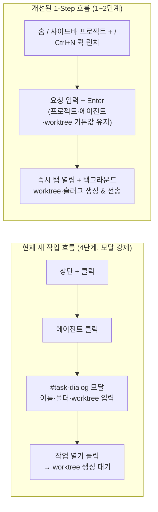
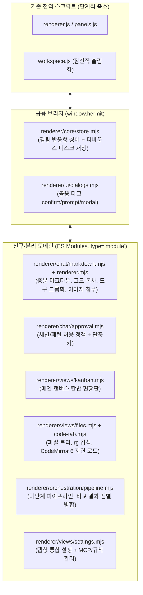

# Hermit 에이전트 IDE 종합 개선·확장 마스터 플랜 (v2 심층 구체화)

> **기준 저장소:** `guseoh/hermit` (`dc07cb3`, 배포 v0.1.7)  
> **문서 목적:** 바로 코드를 고치기 전에, **현재 코드의 실제 병목·불편 지점(UX 마찰)을 전수 진단**하고, **Orca · T3 Code · Conductor · Codex App · Claude Code Desktop · Google Antigravity (2.0 / IDE / `agy`)**의 검증된 패턴을 Hermit의 정체성(Windows PowerShell 5.1 · 초경량 Electron · BYOS 로컬 CLI)에 맞게 선별 반영한 **아키텍처·기능·디자인·UI/UX 종합 청사진**을 수립한다.  
> **아키텍처 원칙:** 전면 재작성 대신 **점진적 모듈 분리**(수정·신규 도메인부터 번들러 없는 ES Modules + 경량 Store로 분리)를 채택한다.

---

## 1. 목표 및 문제 정의 (Goal Description)

Hermit은 이미 기술적 기반이 탄탄하다. 공용 `codex app-server` 멀티플렉싱([codex-host.cjs](../../codex-host.cjs)), 지속 `claude` stream-json 세션([claude.cjs](../../claude.cjs)), Named Pipe TUI 훅([agent-hooks.cjs](../../agent-hooks.cjs)), 임시 인덱스 기반 Git 체크포인트([checkpoints.cjs](../../checkpoints.cjs)), PowerShell OSC 777 명령 결과 구조화([prompt.ps1](../../prompt.ps1)) 등 핵심 엔진은 완성도가 높다.

그럼에도 **실사용에서 "많이 불편하다"고 느껴지는 본질적 이유**는 다음 4가지에 집중되어 있다.

1. **작업 시작·전환·승인·검토 동선의 과도한 마찰:** 새 작업 하나를 시작하려면 팝오버 → 모달 → 이름 입력 → 확인까지 4단계를 거쳐야 하고, 매 도구 승인마다 마우스로 "이번만 승인"을 눌러야 하며, diff 줄 선택에 Shift 범위 선택조차 없다.
2. **이중·삼중으로 꼬인 UI/컨텍스트 모델:** 터미널이 3가지 다른 규칙(플로팅 터미널 / 에디터 탭 셸 / TUI 강제 최대화 드로어)으로 흩어져 있고, 플로팅 터미널 버튼이 화면 3곳에 중복되며, 채팅을 분할하면 브랜치·PR·보기 전환 헤더가 아예 사라진다.
3. **핵심 IDE 기본기의 공백:** 파일 트리·전역 코드 검색(`rg`)이 없고, 소스 보기가 읽기 전용 `<textarea>` 모달에 갇혀 있으며, 마크다운에 링크·코드 복사 버튼·구문 강조가 없고, 이미지 붙여넣기가 불가능하다.
4. **구조적·성능적 결함 잔존:** 3,757줄 단일 전역 [workspace.js](../../workspace.js), 매초 `localStorage` 전체 직렬화, 미수정된 P1/P2 버그(공용 Codex 세션에서 타 스레드 승인 초기화, `changes.cjs` NUL 바이트, Claude TUI 대화 유실, 체크포인트 되돌리기 취소 경합)가 남아 있다.

---

## 2. User Review Required & Open Questions

> [!IMPORTANT]
> 본 문서는 **구현 전 방향 합의용 종합 청사진**입니다. 아래 5가지 의사결정 포인트에 대한 의견을 주시면, 확정된 Phase 1부터 구체적인 코드 수정 작업(PR 단위)으로 착수하겠습니다.

| # | 결정 항목 | 제안안 (Recommended) | 대안 |
|---|---|---|---|
| **Q1** | **터미널 모델 통합 방향** | **작업 하단 접이식 터미널(또는 에디터 분할 탭) 1원화** + 플로팅 터미널은 단축키(`Ctrl+Alt+A`) 보조 수단으로만 유지하고 중복 버튼 2개 제거 | 현재처럼 상단 에디터 탭 + 전역 플로팅 2트랙 유지하되 버튼 중복만 정리 |
| **Q2** | **Worktree 생성 시 `.env` / `node_modules` 처리** | 프로젝트 루트 `.worktreeinclude` 지원(무시된 설정 파일 복사) + Windows 디렉터리 정션(`fs.symlink(..., 'junction')`, 관리자 권한 불필요)으로 `node_modules` 선택적 공유 | 순수 `git worktree add`만 유지하고 실행 프로필로 설치 명령 수동 실행 |
| **Q3** | **경량 코드 뷰어/편집기 도입 범위** | Phase 2에서 **CodeMirror 6**을 TipTap처럼 `vendor/`로 지연 로드해 읽기·구문 강조·간단한 수동 수정·Side-by-Side Diff 지원 | 외부 에디터(`code`/`cursor` 열기) 연동만 추가하고 내부는 읽기 전용 뷰어 유지 |
| **Q4** | **첫 실행(착수) 우선순위** | **Stage A(치명 버그·성능·즉시 체감 UX 7대 개선)** → **Stage B(채팅·승인·컴포저 고도화 + 점진적 ES 모듈 분리 시작)** → **Stage C(파일 탐색/검색·워크트리 자동화·오케스트레이션)** 순으로 진행 | 특정 기능(예: 파일 탐색기 또는 다단계 오케스트레이션)을 최우선으로 앞당김 |
| **Q5** | **Google Antigravity 반영 범위** | **① UX·기능 벤치마크 패턴 선별 도입**(확장 `@` 멘션, 라이브 체크리스트, 프로젝트별 명령 Allowlist/Denylist, Pin/Archive, `.agents/` 규칙 통합) + **② `agy` CLI를 3번째 에이전트 프로바이더로 단계적 연동**(TUI 먼저 → `AgentAdapter` 채팅·3자 비교) | 벤치마크 UX·기능 패턴만 참고하고 에이전트 프로바이더는 Codex·Claude 2종 유지 |

---

## 3. 타 에이전트 IDE 벤치마크 및 선별 도입 전략

무조건 따라 하지 않고, **Hermit의 원칙(Windows 네이티브, 가벼운 메모리, PowerShell 강점, 로컬 CLI BYOS)**에 맞는지 기준으로 **채택(Adopt) / 변형 도입(Adapt) / 비도입(Skip)**을 명확히 구분했다.

| 기능 / UX 패턴 | 참고 도구 | Hermit 적용 판정 | 선별 사유 및 Hermit 맞춤 설계 |
|---|---|---|---|
| **1-Step 즉시 작업 시작 (프롬프트 입력 → 자동 worktree·슬러그 생성)** | T3 Code, Codex App, Claude Desktop | **채택 (Adopt)** | 현재 4단계 모달 왕복이 가장 큰 마찰. 홈/새 작업 바에서 프롬프트 입력 후 `Enter` 한 번으로 브랜치명 자동 생성 + worktree 생성 + 즉시 전송. 상세 옵션(비교/역할)은 펼침/모달로 분리. |
| **`.worktreeinclude` + 의존성 정션 공유** | Orca (`orca.yaml`), Claude Desktop (`.worktreeinclude`) | **변형 도입 (Adapt)** | worktree를 만들 때마다 `.env`가 빠지고 `npm ci`를 다시 돌리는 것은 치명적 불편. `.worktreeinclude` 파일 복사 + Windows Junction(`mklink /J` 동등, 권한 불필요)으로 `node_modules` 옵션 공유 + 프로젝트별 `postCreate` 명령 지원. |
| **작업 중심 3단 레이아웃 + 에이전트 현황 대시보드** | Orca, T3 Code, Conductor | **변형 도입 (Adapt)** | Orca식 단색 3단 틀은 이미 잘 이식됨. 단, 칸반 현황판은 350px 우측 사이드바에서 빼내 **메인 캔버스 전체 폭 탭**으로 승격해야 실용적. |
| **인라인 Diff 리뷰 + Shift 범위 선택 + 다중 Diff 탭** | Orca, T3 Code, Claude Desktop | **채택 (Adopt)** | Hermit은 이미 리뷰 노트 일괄 전송이 강점. 여기에 **Shift+클릭 범위 선택**, **다중 파일 Diff 탭**, **Side-by-Side / Unified 토글**, **노트 → GitHub PR 코멘트 발행**을 더해 완성. |
| **세션/패턴 단위 승인 정책 + 글로벌/프로젝트 오버라이드** | Claude Code, T3 Code, **Google Antigravity 2.0** | **채택 (Adopt)** | 매번 마우스로 "이번만 승인" 클릭하는 피로 제거. `Y`(1회) / `A`(이 세션 허용) / `N`(거절) 단축키 + Antigravity 2.0식 **전역 기본 정책 + 프로젝트별 오버라이드 + 명령 접두사 Allowlist/Denylist**(예: `npm test`·`git status` 항상 허용, `rm -rf`·`git push --force` 항상 차단). |
| **실시간 진행 체크리스트 & Planning 모드(실행 전 승인)** | **Google Antigravity (2.0 / IDE)** | **채택 (Adopt)** | 현재 Hermit은 `turn/plan/updated`가 칸반 카드 1줄로만 스쳐 지나감. 채팅 상단 고정 **라이브 체크리스트 바** + 복잡한 작업의 실행 전 계획 확인(`plan` 검토→실행) 및 완료 요약 카드를 제공하면 긴 작업의 불안감과 오작동을 크게 줄임. |
| **확장 `@` 멘션 & 워크플로 슬래시 커맨드** | **Google Antigravity 2.0**, Cursor | **채택 (Adopt)** | 현재 `@`는 `git ls-files` 파일만 지원. Hermit이 이미 가진 자산인 **`@터미널`(최근 명령 출력), `@작업`(이전 대화 컨텍스트), `@노트`, `@규칙`**까지 `@` 하나로 통합하고, `/plan`, `/review`, `/compact`, `/handoff` 및 프로젝트 스킬(`/스킬명`)을 지원해 패널 왕복을 없앰. |
| **대화 고정(Pin)·태그·아카이브 & 우측 보조 관측 패널** | **Google Antigravity 2.0** | **변형 도입 (Adapt)** | 작업이 10개 이상 쌓이면 현재 사이드바(열림/닫힘 2단)가 금방 어지러워짐. 작업 카드에 **고정(Pin)·아카이브·태그 필터**를 추가하고, 우측 보조 패널에서 변경 파일·검증 실행·백그라운드 프로세스를 일관되게 관측. |
| **채팅 ↔ TUI 무손실 전환 + WebGL 분할 터미널** | Orca | **채택 (Adopt)** | Claude TUI 복귀 시 세션 JSONL 동기화로 대화 유실 제거 + `@xterm/addon-webgl` 적용 + TUI 종료 버튼/전환 일관화. |
| **사이드바 파일 트리 + `rg` 전역 검색 + 탭 코드 뷰어** | Orca, Claude Desktop | **변형 도입 (Adapt)** | Monaco(무거움) 대신 `rg` + 지연 로드 **CodeMirror 6**로 메모리 목표를 지키면서 코드 탐색·미세 편집 해결. |
| **원버튼 커밋→푸시→PR + Squash 병합 감지 정리** | T3 Code, Orca | **채택 (Adopt)** | 현재 스마트 분할 버튼의 자연스러운 확장. AI PR 제목/본문 생성 + GitHub API 기반 squash 병합 감지 후 "worktree 정리할까요?" 제안. |
| **스레드 중간 프로바이더 교체 / 다단계 파이프라인** | T3 Code, Conductor, **Google Antigravity (`agy`)** | **변형 도입 (Adapt)** | Hermit의 강점인 양방향 이어받기·병렬 비교를 확장해 **프리셋 파이프라인(설계→구현→리뷰→검증)** 및 **비교 결과 파일별 선별 병합**으로 차별화. 장기적으로 `agy` CLI까지 3번째 프로바이더로 통합 가능. |
| **MCP / `AGENTS.md` / `CLAUDE.md` / `.agents/` 통합 관리** | T3 Code, Codex App, **Google Antigravity** | **변형 도입 (Adapt)** | 별도 MCP 서버를 띄우는 대신, 로컬 `CLAUDE.md`, `AGENTS.md`, **`.agents/`(스킬·규칙)**, `.mcp.json`을 한 화면에서 확인·편집·토글하는 경량 허브로 도입. |
| **예약·반복 작업(Scheduled Tasks) / OS 터미널 샌드박스** | **Google Antigravity 2.0**, Codex App | **보류 (Later)** | 트레이 상주 앱이므로 추후 야간 테스트·PR 감시 자동화로 확장 가능하나, 핵심 UX 마찰 해소 이후로 배치. Windows OS 레벨 샌드박스 역시 구현 복잡도 대비 Allowlist/Denylist + Worktree + 체크포인트가 우선. |
| **임베디드 브라우저 디자인 모드 / 자동화 브라우저** | Orca, **Google Antigravity** | **보류 (Later)** | 현재 `localhost` iframe 프리뷰에 **콘솔 오류/스크린샷 캡처 → 대화 첨부**만 경량으로 붙이는 것이 현실적. 전체 브라우저 자동화/DOM 인스펙터는 유지보수 비용 과다. |
| **인라인 Tab 자동완성 / Code Lenses / 풀 IDE 통합** | **Google Antigravity IDE**, Cursor | **비도입 (Skip)** | Hermit은 풀 코드 에디터가 아닌 **에이전트 작업대(ADE)**이므로 편집기 내 Tab 예측·심볼 렌즈는 범위 밖. |
| **클라우드 VM / SSH 원격 호스트 / 모바일 앱 / Slack 봇 / 멀티플레이어** | Orca, T3 Code, Conductor | **비도입 (Skip)** | 서버 인프라·인증·동기화 복잡도가 폭증하며 Hermit의 핵심 가치(Windows 로컬 PowerShell 작업대, 초경량, 개인 생산성)에서 벗어남. |
| **Monaco 에디터 / 다국어 i18n / 플러그인 마켓** | Orca | **비도입 (Skip)** | 번들·메모리 목표 위배 및 1인/소규모 유지보수 범위 초과. |

---

## 4. UI/UX 편의성·사용성 정밀 진단 및 개선 설계 (Pain Point → Solution)

현재 코드에서 확인된 **실사용 불편 지점 10가지**와 구체적인 Before/After 개선안이다.

### 4.1 핵심 동선별 마찰 해소



| # | 현재 불편 사항 (실제 코드 근거) | 개선 UI/UX 설계 | 체감 효과 |
|---|---|---|---|
| **UX-1** | **새 작업 시작이 4단계 모달 왕복** ([index.html](../../index.html#L39-L59), [workspace.js](../../workspace.js#L1349-L1456)) | ① 홈 화면과 `Ctrl+N` 퀵 런처에 **바로 요청을 쓰고 Enter로 시작하는 입력창** 배치(에이전트·프로젝트·worktree 토글 인라인). ② 작업 이름을 비우면 첫 줄에서 자동 생성. ③ 프로젝트 행의 `+` 버튼을 `PowerShell 열기` 대신 **이 프로젝트에 새 작업 시작**(우클릭/보조 아이콘은 PowerShell)으로 전환. | 새 작업 시작 시간 70% 단축 |
| **UX-2** | **터미널 경로 3중 분산 + 버튼 3곳 중복** (`#toggle-terminal`, `#nav-floating-terminal`, `#quick-tools-trigger`가 모두 플로팅 터미널 열기; 우하단 버튼이 우측 패널 커밋 버튼을 가려 `padding-bottom: 46px` 땜빵 존재 — [styles.css](../../styles.css#L1016), [L1293](../../styles.css#L1293)) | ① 우하단 플로팅 `#quick-tools-trigger` 및 미사용 `#quick-tools` 팝오버 **제거**(우측 패널 가림 해소). ② 터미널 진입점을 **작업 하단 접이식 터미널(또는 에디터 탭)** + **단축키 `Ctrl+Alt+A` 전역 플로팅**으로 역할 명확화. ③ TUI 모드도 별도 강제 최대화 해킹(`body.codex-terminal-mode`) 대신 해당 작업 패널 안에서 자연스럽게 `[채팅 \| 터미널]`로 전환하며, 버튼 하나로 안전 종료(`/exit` 수동 입력 강요 제거). | 화면 노이즈 제거, 멘탈 모델 일관화 |
| **UX-3** | **분할 채팅 패널에서 헤더 정보·기능 실종** ([workspace.js](../../workspace.js#L703-L716), [L2457-L2493](../../workspace.js#L2457-L2493)): `renderTaskHeader`가 `primaryChatPanel`의 전역 ID(`#task-branch`, `#task-pr`, `#task-view-switch`)만 갱신해 분할된 채팅 탭에는 브랜치·PR·비교·TUI 전환이 안 보임 | `createDockedChat()` 템플릿 안에 **자체 경량 작업 컨텍스트 바**(브랜치 칩, PR 상태 칩, 결과 비교 버튼, `[채팅 \| 터미널]` 스위치, 빠른 터미널 열기)를 포함시켜 어느 패널에 놓든 동일한 기능 제공. | 멀티 채팅 분할 작업의 완성도 확보 |
| **UX-4** | **채팅 입력창 & 메시지 조작 불편** (`rows="2"` 고정, 이미지 첨부 불가, `@`는 파일만 지원, 코드 복사 버튼 없음, 진행 단계가 칸반에만 노출, 전송 전 체크포인트 8초 블로킹) | ① 입력창 **자동 높이 확장**(1~10줄). ② **Ctrl+V / 드래그 이미지 첨부** + 썸네일 프리뷰 칩. ③ **확장 `@` 멘션**(`@파일`, `@터미널`, `@작업`, `@노트`, `@규칙`) & 슬래시 커맨드(`/plan`, `/review`, `/compact`, `/스킬`). ④ 채팅 상단 **실시간 진행 체크리스트 바** 고정. ⑤ 코드 블록 **언어 배지 + 복사 버튼**, 메시지 하단 호버 액션(**복사 · 재전송 · 여기서 분기**), 연속 읽기 도구 **1줄 그룹 접기**. ⑥ 체크포인트 200ms 이상 시 비블로킹 상태 표시. | 매일 가장 오래 머무는 채팅 화면의 피로도·패널 왕복 급감 |
| **UX-5** | **승인(Approval) 클릭 지옥 & 네이티브 `confirm()`** ([workspace.js](../../workspace.js#L910-L931), [L965](../../workspace.js#L965)) | ① 승인 카드에 **`[이번만 허용 (Y)]` `[이 세션 허용 (A)]` `[이 명령 항상 허용]` `[거절 (N)]`** + 명령 위험도 요약. ② Antigravity 2.0식 **전역 + 프로젝트별 명령 접두사 Allowlist/Denylist** 규칙 관리. ③ 대기 승인 배지 클릭 또는 `Ctrl+Shift+Y`로 다음 승인 작업 즉시 점프. ④ `confirm()` 3곳을 앱 공용 다크 확인 `<dialog>`로 전면 교체. | 키보드만으로 승인 루프 처리 가능, 시각 일관성·안전성 동시 확보 |
| **UX-6** | **Diff 검토의 좁은 폭 + Shift 범위 선택 부재 + 단일 탭 제한** ([workspace.js](../../workspace.js#L3275-L3282), [L3374](../../workspace.js#L3374)) | ① Diff 줄 선택 시 **Shift+클릭 범위 선택** 및 드래그 선택 지원, 선택 즉시 미니 플로팅 툴바(`[+ 리뷰 노트]` `[대화에 첨부]`) 표시. ② Diff 파일을 메인 WorkArea에서 **여러 파일 탭으로 동시 열기** + Unified/Side-by-Side 전환. ③ 변경 파일의 스테이지 `+`/`-` 버튼을 호버 숨김에서 옅은 상시 표시로 변경(발견성 향상). | 코드 리뷰·피드백 속도 2배 이상 향상 |
| **UX-7** | **파일 트리 부재 & 읽기 전용 `<textarea>` 모달** ([workbench-tools.js](../../workbench-tools.js#L821-L866)) | ① 우측 패널에 **파일 탐색기 탭(트리 + `rg` 이름/내용 검색)** 추가. ② 파일 클릭 또는 터미널 에러 `파일:행` 클릭 시 모달 대신 **메인 WorkArea 탭**으로 열고 해당 행 하이라이트 + 선택 줄 바로 대화 첨부. | 작업 흐름을 끊지 않고 코드와 대화를 나란히 확인 |
| **UX-8** | **칸반 현황판이 350px 사이드바에 압착** ([styles.css](../../styles.css#L1168)) | 좌측 사이드바 `에이전트 현황` 클릭 시 **메인 캔버스 전체 폭 칸반 탭**으로 열기. 각 카드에 경과 시간, 변경 파일 수(`+12 -3`), 현재 plan 단계, `[승인]`/`[중단]` 원클릭 액션 배치. | 병렬 에이전트 관제탑 역할 수행 |
| **UX-9** | **키보드 탐색 단축키 부족** ([keybindings.js](../../keybindings.js)) | IDE 표준 단축키 보강: `Ctrl+N`(새 작업 퀵 런처), `Ctrl+P`(파일 빠른 열기), `Ctrl+Shift+F`(프로젝트 전역 검색), `Ctrl+Tab`/`Ctrl+Shift+Tab`(최근 탭 전환), `Ctrl+1~9`(탭 직접 이동), `Alt+Left/Right`(이전/다음 작업 탐색), `Ctrl+W`(현재 탭 닫기, 터미널 제외). | 마우스 이동 최소화 |
| **UX-10** | **작업/탭 소유권 혼란 및 많은 작업 관리 부재** ([panels.js](../../panels.js#L316-L324)) | ① 탭 줄에 활성 작업 소유 탭과 공용 탭을 구분하고, 탭 우클릭 메뉴(`분할`, `고정/공용 전환`, `다른 탭 닫기`, `경로 복사`, `외부 에디터 열기`) 제공. ② 사이드바 작업 카드에 **고정(Pin) · 아카이브 · 태그 필터** 추가(Antigravity 2.0 방식) + `닫은 작업`에 **"병합된 worktree 일괄 정리"** 제공. | 장기간·다수 작업 운용 시 탐색성 유지 및 디스크 누적 방지 |

### 4.2 개선된 화면 레이아웃 와이어프레임 (목표 구조)

```text
┌──────────────────────────────────────────────────────────────────────────────┐
│ [Hermit] [◫]  [● 로그인 수정 ×][! 결제 테스트 ×][📄 auth.ts ×][+]    [◫ 우측] │ 36px 타이틀바
├─────────────────┬───────────────────────────────────────┬────────────────────┤
│ 🔍 검색 (Ctrl+K)│ [● 로그인 수정] [⑂ agent/login] [PR#12]│ [⑂변경][📁파일][🔍]│
│ ✦ 새 작업  ^N   │              [채팅 | 터미널] [비교] [⋮]│ [⑂PR][▤메모][>_결과]│
│ ▦ 현황판 (탭)   ├───────────────────────────────────────┼────────────────────┤
│─────────────────│                                       │ 변경사항 (3)  [+모두]│
│ ▾ my-app   [+]  │  사용자: 로그인 오류 고쳐 줘 [↩ 되돌리기]│  M src/login.ts +12│
│   ● 로그인 수정 │                                       │  M src/api.ts   -3 │
│     ⑂ agent/log │  ✳ Claude Code                        │  A test/auth.js +40│
│   ! 결제 테스트 │  ▸ 파일 5개 읽음 · 테스트 실행 ✓ 1.8s │ ────────────────── │
│   ▸ 닫은 작업(3)│  원인을 수정했습니다.                 │ 리뷰 노트 (2) [전송]│
│                 │  ┌ ts ─────────────────────── [복사]┐ │ ────────────────── │
│                 │  │ const ok = verify(token);        │ │ [커밋 메시지  ✦AI] │
│                 │  └──────────────────────────────────┘ │ [  커밋 ▾        ] │
│                 │  [복사] [여기서 분기]                  │                    │
│                 │ ┌ 승인: npm test ───────────────────┐ │                    │
│                 │ │ [허용 Y] [세션 허용 A] [거절 N]   │ │                    │
│                 │ └───────────────────────────────────┘ │                    │
│                 │ ┌───────────────────────────────────┐ │                    │
│                 │ │ [@파일 /명령 · 이미지 붙여넣기…]   │ │                    │
│                 │ │ [📎] [Opus ▾] [추론 ━━●] [이어받기](↑)│ │                │
│                 │ └───────────────────────────────────┘ │                    │
│                 │ ✳ Claude · my-app · ⑂ agent/login · 34% 컨텍스트           │
│ [⚙ 설정] [⌘K]   │══ 작업 터미널 [PowerShell][dev :5173 🌐][+] [⌃] ═══════════│
├─────────────────┴───────────────────────────────────────┴────────────────────┤
│ 남음 ✳ ▬ 92% 4h · ◎ ▬ 98% 4h ↻   │  [절전 허용] [리소스 310MB] [업데이트]   │ 24px 상태줄
└──────────────────────────────────────────────────────────────────────────────┘
```

---

## 5. 디자인 시스템 고도화

현재 [STYLEGUIDE.md](../STYLEGUIDE.md)와 [styles.css](../../styles.css)의 완성도는 높으므로 **정체성(단색·조용함·상태에만 색)은 유지**하면서 아래 결함을 정리한다.

1. **토큰 위반 일소:** `styles.css` 내 잔존 하드코딩 hex 7곳(`#ef4444`, `#71717a`, `#73c991`, `#3fb950`, `#ab7df8`, `#fff`)을 시맨틱 토큰(`--status-failed`, `--pr-open`, `--pr-merged`, `--diff-new`, `--divider-active`)으로 치환하고, dead 셀렉터(`.change-file[data-kind=untracked]` → `new`)와 1001행 포맷 오류를 수정한다.
2. **라이트 테마 & 시스템 테마 연동:** `:root[data-theme="light"]` 토큰 세트 추가 및 `nativeTheme.themeSource` 연동(`system` / `dark` / `light`).
3. **보안·승인 서피스 강화 (Orca 규칙 10 반영):** 승인 카드와 파괴적 확인 모달(worktree 강제 삭제, `main` 푸시, 체크포인트 복원)에 테마와 무관하게 시인성이 보장되는 전용 보안 서피스 스타일 적용.
4. **모달 → 통합 탭형 설정 화면:** `#chat-settings` 모달을 **일반 · 에이전트/CLI · 터미널 · 승인/보안 · 알림/업데이트 · 모양/테마 · 단축키** 좌측 탭 구조로 개편.

---

## 6. 점진적 아키텍처 모듈화 및 결함 정비 계획

### 6.1 선행 수정할 구체적 버그·성능 병목 (Stage A)

| 분류 | 파일 및 위치 | 현황 및 수정 방안 |
|---|---|---|
| **P1 동시성 버그** | [agent.cjs](../../agent.cjs#L176-L180), [codex-host.cjs](../../codex-host.cjs#L45-L49) | 공용 `CodexSession.receive()`가 `turn/completed` 시 `this.approvals.clear()`로 **타 스레드의 대기 승인까지 지워버리는 버그**. → 승인 맵에 `threadId`를 함께 저장해 해당 스레드 승인만 정리하도록 수정. |
| **P1 바이너리 오인** | [changes.cjs](../../changes.cjs#L588) | `output.split(...)` 안의 실제 `0x00` NUL 바이트를 이스케이프 문자열 `'\0'`로 교체. |
| **P1 프로세스 누수** | [claude.cjs](../../claude.cjs#L253-L295) | Windows에서 `child.kill()` 대신 `CodexSession.close()`와 동일한 공용 `killProcessTree(child)` (`taskkill /PID /T /F`) 유틸로 추출해 적용. |
| **P2 데이터 유실** | [claude.cjs](../../claude.cjs), [main.cjs](../../main.cjs#L310-L327), [workspace.js](../../workspace.js#L2522-L2529) | Claude TUI 종료 후 채팅 복귀 시 `~/.claude/projects/<encoded-cwd>/<sessionId>.jsonl`에서 TUI 대화 내역을 읽어 `claude-history`와 동기화하고, 첫 요청 전 TUI를 연 경우에도 `sessionId`를 생성·전달해 세션 단절 방지. |
| **P2 체크포인트 경합** | [workspace.js](../../workspace.js#L962-L984), [L1661](../../workspace.js#L1661) | 토스트 "되돌리기 취소" 콜백에도 `state.busy`/`state.restoring` 가드를 적용하고 `sendChatText`가 `state.restoring` 중 전송을 차단하도록 직렬화. |
| **P2 성능 (직렬화)** | [renderer.js](../../renderer.js#L26-L35) | 매초 `localStorage` 전체 `JSON.stringify` 폴링 제거 → `Storage.prototype.setItem`/`removeItem` 래핑(또는 상태 헬퍼 `persistKey`)으로 **변경 발생 시에만 1초 디바운스 저장**. |
| **P2 성능 (PR·리소스)** | [workspace.js](../../workspace.js#L1179-L1190), [resources.cjs](../../resources.cjs) | `watchPullRequests`에 `document.hidden` 가드 + 저장소 단위 묶음 조회 적용; `resources.cjs`는 PowerShell CIM 2회 대신 `app.getAppMetrics()` + 경량 프로세스 조회로 개선. |
| **P3 문구/레거시** | [renderer.js](../../renderer.js#L982), [index.html](../../index.html#L34), [L271-L275](../../index.html#L271-L275) | Claude TUI 닫기 문구 하드코딩 수정, dead DOM(`#switch-codex-view`, `#new-task`, `#quick-tools`) 및 중복 바인딩 정리. |

### 6.2 점진적 모듈 분리 전략 (Zero-Bundler ES Modules)

기존 전역 스크립트(`renderer.js`, `panels.js`, `workspace.js`)를 한 번에 뒤엎지 않고, **브리지 패턴(Bridge Pattern)**으로 새 기능 및 수정 도메인부터 `renderer/` ES 모듈로 이전한다.



- **안전성:** CSP `script-src 'self'`를 그대로 유지하면서 번들러 없이 Node 테스트(`node --test`)로 순수 모듈(`store.mjs`, `markdown.mjs`, `approval.mjs`, `pipeline.mjs`)을 직접 단위 테스트할 수 있다.
- **메인 프로세스 확장:** 기존 `main.cjs`에 IPC를 계속 덧붙이지 않고 `main/files.cjs`(트리·`rg` 검색), `main/worktree-setup.cjs`(`.worktreeinclude`·정션), `main/approval-policy.cjs`, `main/claude-history-sync.cjs`, `main/adapters/`로 도메인별 모듈을 분리 등록한다.

### 6.3 3대 에이전트 프로바이더 확장 설계: Codex · Claude Code · Google Antigravity (`agy`)

현재 Hermit은 `provider === 'claude' ? ... : 'codex'` 이진 분기가 [main.cjs](../../main.cjs), [agent.cjs](../../agent.cjs), [workspace.js](../../workspace.js) 전반에 흩어져 있다. 이를 공통 **`AgentAdapter` 레지스트리**(`codex` / `claude` / `antigravity`)로 정규화하면 Google Antigravity(`agy`)를 자연스럽게 3번째 에이전트로 통합할 수 있다.

1. **1단계 — 경량 TUI & 환경 연동 (Stage B~C, 낮은 비용):**
   - `agent-probe.ps1`과 `prompt.ps1`에 `agy` CLI 탐지·실행·종료 감지를 추가하고, 새 작업 메뉴/터미널 런처에서 **Antigravity (`agy`)**를 바로 실행.
   - `~/.gemini/antigravity-cli/settings.json` 및 프로젝트 `.agents/`(스킬·규칙)를 Hermit의 에이전트 설정 허브에 통합.
2. **2단계 — 통합 채팅·비교·이어받기 어댑터 (Stage C~D):**
   - `main/adapters/antigravity.cjs`를 통해 `agy` 스트리밍 CLI 또는 로컬 Antigravity `ConversationService`(Connect HTTP+JSON) / Python SDK 브리지를 `turn/started`, `item/agentMessage/delta`, `item/thought`, `approval`, `turn/completed` 공통 이벤트로 정규화.
   - **Codex · Claude Code · Antigravity 3자 선택 비교** 및 **양방향/3방향 이어받기**로 확장.

---

## 7. 종합 확장·추가 항목 마스터 표 (우선순위·단계 매핑)

### 7.1 기존 기능 확장 (Extend)

| 단계 | 영역 | 현재 상태 | 구체적 확장 내용 | 기대 효과 |
|---|---|---|---|---|
| **Stage A** | **안정성·성능 기반** | P1/P2 버그 5건, 매초 전체 직렬화, PR 숨김 폴링 | 공용 Codex 승인 스레드 격리, `changes.cjs` NUL 수정, Claude 프로세스 트리 종료, Claude TUI 대화 동기화, 체크포인트 경합 차단, dirty-flag 저장, `confirm()` 다크 모달화 | 데이터 유실·잠금·UI 끊김 원천 해소 |
| **Stage A** | **터미널 & 분할 UX 통일** | 3중 터미널, 중복 버튼 3개, 분할 채팅 헤더 누락 | `#quick-tools-trigger` 제거, 분할 채팅별 작업 컨텍스트 바(브랜치·PR·TUI 전환), TUI 원클릭 종료, `Ctrl+N/P/Tab/1~9` 단축키 보강 | 일관된 조작감과 화면 공간 확보 |
| **Stage A** | **에이전트 현황판** | 350px 우측 패널 가로 스크롤 칸반 | 메인 WorkArea 전체 폭 칸반 탭 승격, 카드에 변경 수치·경과 시간·원클릭 승인/중단 추가 | 다중 에이전트 병렬 관제 실용화 |
| **Stage B** | **채팅 & 마크다운** | 단순 정규식 파서, 전체 재렌더, 2줄 고정 입력창, `@` 파일 한정 | 링크·체크박스·구문 강조·**코드 복사 버튼**, 스트리밍 증분 렌더, 연속 읽기 도구 그룹 접기, 자동 높이 입력창, **확장 `@` 멘션(`@터미널/@작업/@노트/@규칙`)**, 채팅 상단 **라이브 체크리스트 바**, 메시지 복사/분기, Claude/Antigravity `thinking` 표시 | 핵심 체류 화면의 가독성·편의성·진행 파악력 대폭 상승 |
| **Stage B** | **승인 정책 엔진** | "이번만 승인/거절" 마우스 클릭 전용 | `Y`/`A`/`N` 단축키, **세션 단위 허용**, **전역+프로젝트 명령 접두사 Allowlist/Denylist** (Antigravity 2.0 모델), 승인 대기 점프 단축키 | 반복 승인 클릭 피로 해소 및 안전 경계 명확화 |
| **Stage B** | **Diff & Git/PR 흐름** | 단일 Diff 탭, 단건 클릭 선택, `is-ancestor` 단독 판단 | **Shift 범위 선택** + 인라인 플로팅 액션, **다중 Diff 탭**, Unified/Side-by-Side 전환, **GitHub API squash 병합 감지**, 리뷰 노트 → **GitHub PR 인라인 코멘트 발행**, AI PR 제목/본문 작성 | 리뷰→수정→PR→정리 루프 완결 |
| **Stage C** | **Worktree 환경 자동화** | 순수 `git worktree add`만 수행 | `.worktreeinclude` 설정 파일 자동 복사 + Windows Junction(`node_modules`) 선택 공유 + 프로젝트별 `postCreate` 훅 | 새 worktree 생성 직후 즉시 빌드/테스트 가능 |
| **Stage C** | **멀티-에이전트 오케스트레이션** | 2종 비교(택1) + 1단계 이어받기 예약 | **다단계 파이프라인**(설계→구현→리뷰→검증 자동 루프), 실패 재시도/폴백, 병렬 비교 결과의 **파일 단위 선별 병합(Cherry-pick)** | Hermit만의 독보적 멀티-에이전트 강점 극대화 |
| **Stage C** | **터미널 & 자동 업데이트** | DOM 렌더러, 5.1 고정, 무음 업데이트 | `@xterm/addon-webgl`, `pwsh`(PS7)/WSL 프로필, `localhost:포트` 자동 감지 배너, 종료 시 업데이트 진행 안내 및 재실행 옵션, Actions Node 24 업그레이드 | 출력 성능·환경 호환성·배포 신뢰성 향상 |

### 7.2 신규 기능 추가 (Add)

| 단계 | 영역 | 제안 기능 | 구체적 구현 포인트 | 기대 효과 |
|---|---|---|---|---|
| **Stage A** | **1-Step 작업 런처** | 프롬프트 즉시 시작 런처 | 홈/퀵 런처에서 요청 입력 후 Enter 즉시 worktree 생성·연결·전송; 프로젝트 행 `+` 원클릭 작업 시작 | 작업 시작 진입 장벽 제거 |
| **Stage B** | **멀티모달 & 컨텍스트** | 이미지 첨부 + 컨텍스트 게이지 + 작업 템플릿 | Ctrl+V/드래그 스크린샷 첨부(임시 파일/이미지 블록 전달), 입력창 하단 컨텍스트 사용률 표시, 재사용 프롬프트 템플릿(버그수정/리뷰/테스트) | UI 디버깅·반복 프롬프트 효율 극대화 |
| **Stage B** | **파일 탐색 & 검색** | 사이드바 파일 트리 + `rg` 전역 검색 | 우측 패널 파일/검색 탭, 지연 로드 폴더 트리, `rg --json` 내용 검색, 결과 클릭 시 메인 탭으로 즉시 열기 | 코드베이스 탐색을 앱 안에서 완결 |
| **Stage B** | **경량 코드 탭** | CodeMirror 6 지연 로드 소스 뷰어/편집기 | `vendor/code-editor.js` 지연 로드(TipTap 방식), 구문 강조·줄 번호·간단한 수동 편집 저장·선택 줄 대화 첨부 | 메모리 경량 원칙 유지 + 모달 `<textarea>` 탈피 |
| **Stage C** | **에이전트 설정 허브** | MCP · `CLAUDE.md` · `AGENTS.md` · `.agents/` 통합 관리 + 탭형 설정 | 프로젝트/전역 지침 파일 및 `.agents/`(스킬·규칙) 편집, MCP 서버 목록/상태 확인, 좌측 탭형 설정 화면, **라이트/시스템 테마** 추가 | Codex·Claude·Antigravity 설정 파편화 해소 |
| **Stage C** | **지식 검색 & 관측성** | 전역 대화·명령 출력 검색 + 비용($) 리포트 + 로컬 포트 대시보드 | JSONL 경량 색인 검색, 모델별 단가 기반 일별/프로젝트별 예상 비용, 실행 중인 `localhost` 포트 목록 및 원클릭 프리뷰 | 과거 작업 재활용 및 비용/포트 가시성 확보 |
| **Stage C~D** | **3대 에이전트 통합** | **Google Antigravity (`agy`) 어댑터** 및 공통 `AgentAdapter` | 1단계: `agent-probe`/`prompt.ps1` `agy` TUI 런처 연동 → 2단계: `AgentAdapter` 규격화 + `antigravity.cjs` 채팅·3자 비교·이어받기 통합 | Codex · Claude Code · Antigravity(Gemini)를 한 작업대에서 자유롭게 조합 |

---

## 8. 단계별 검증 전략 (Verification Plan — 향후 실행 시 적용)

각 Stage 구현 시 아래 검증 체계를 단계적으로 유지·확장한다.

### Automated Tests
- **기존 회귀 테스트:** `npm test` (70개 단위·통합 테스트 — `checkpoints.test.cjs` 60초 타임아웃 병목도 Stage A에서 함께 최적화)
- **신규 순수 모듈 테스트 (`test/*.test.cjs`):**
  - 공용 Codex 멀티 스레드 동시 승인 격리 테스트 (`test/codex-host.test.cjs` 확장)
  - Claude TUI 세션 JSONL 동기화 및 프로세스 트리 정리 테스트
  - 체크포인트 되돌리기 취소 중 턴 시작 경합 방지 테스트
  - `renderer/core/store.mjs`, `renderer/chat/markdown.mjs`, `renderer/chat/approval.mjs` 단위 테스트
- **Electron UI 스모크 테스트:** `node test/ui-smoke.cjs` — 1-Step 런처, 분할 채팅 헤더, Shift 범위 diff 선택, 다크 확인 모달, 칸반 중앙 탭, 재시작 레이아웃 복원 시나리오 추가

### Manual Verification
- 격리 프로필(`AGENT_WORKBENCH_PROFILE`)로 `npm start` 실행 후 Codex·Claude 실제 세션을 열어 **동시 승인, 이미지 붙여넣기, 채팅↔TUI 복귀 대화 보존, worktree `.worktreeinclude` 생성 및 정리, 파일 탐색·검색→탭 열기** E2E 흐름 확인
- 리소스 관리자에서 유휴 메모리·CPU 사용량이 기존 대비 증가하지 않았는지(특히 `localStorage` 폴링 제거 및 CodeMirror 지연 로드 효과) 확인
